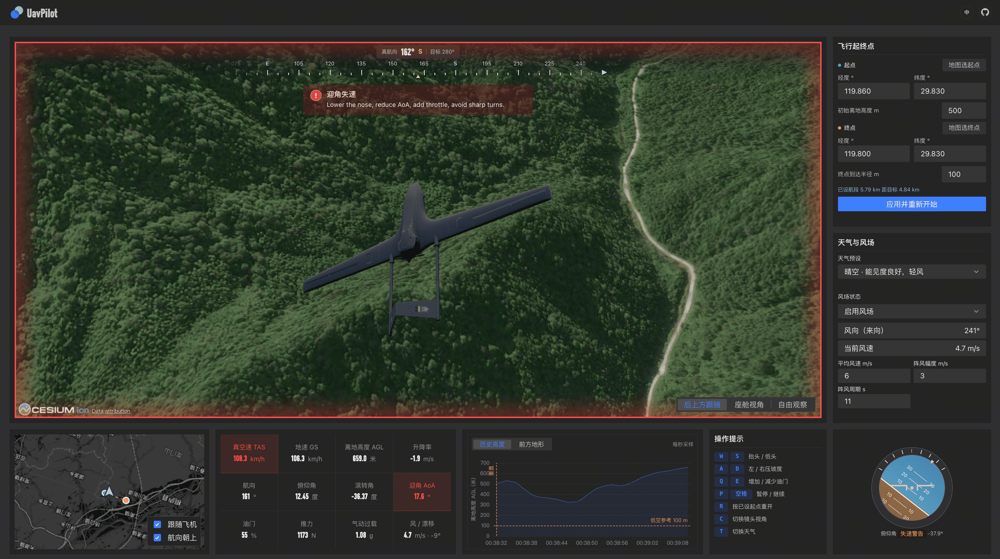
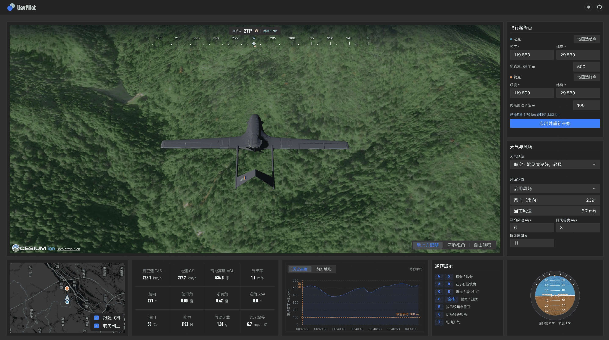

# MF-UavPilot

[简体中文](./README.md) | **English**

> A fixed-wing UAV flight monitoring and simulation interface built with Cesium

> Live demo :<https://fengtianxi001.github.io/MF-UavPilot/#/home>

<h1>
  
</h1>

<h1>
  
</h1>

## Changelog

##### v3.0.1

- [x] Integrated a Cesium 3D globe with ArcGIS satellite imagery and real terrain
- [x] Falls back to the ellipsoid terrain when the terrain service is unavailable
- [x] Configured sun lighting, dynamic atmosphere and soft shadows, with daylight derived from location and time
- [x] Loaded the glb UAV model, scaled to its real wingspan, with throttle-driven propeller rotation
- [x] Implemented the fixed-wing model: lift, drag, thrust, gravity and ISA air density
- [x] Added throttle response lag, attitude inertia recovery, low-speed control loss and angle-of-attack stall
- [x] Added keyboard control for pitch, bank, throttle, pause and restart
- [x] Added an attitude indicator and a true-heading compass tape with target bearing marker
- [x] Added a flight parameter panel: airspeed, ground speed, AGL, vertical speed, AoA, load factor and more
- [x] Added ECharts altitude curves with history and terrain-ahead views
- [x] Added a Leaflet 2D map with follow aircraft, heading-up and flight trail
- [x] Added start/end route planning with coordinate input and map picking
- [x] Map picking supports quick lookup by province / city / district
- [x] Added initial AGL, arrival radius, leg distance and remaining distance readouts
- [x] Added destination arrival detection and restart flow
- [x] Added flight alerts: terrain ahead, low altitude, rapid descent, stall and ground contact
- [x] Added terrain-ahead sampling prediction and a terrain probe ground-contact check
- [x] Added four weather presets: clear, overcast, storm and fog
- [x] Added rain and fog layers, plus a wind field with steady wind and gusts
- [x] Added chase, cockpit and free-look camera modes
- [x] Added Chinese/English switching and screen-adaptive scaling
