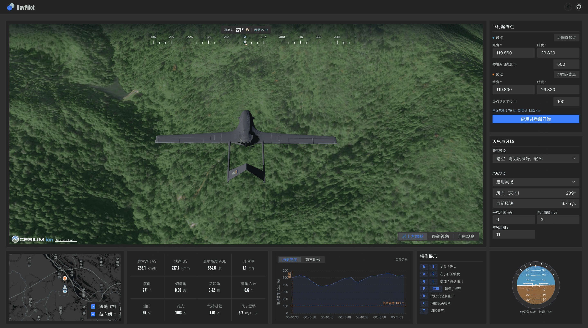
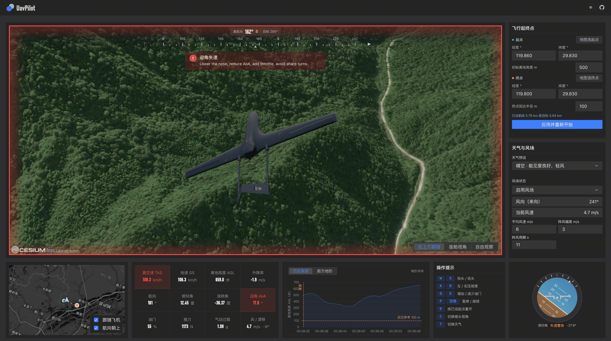

# MF-UavPilot

**简体中文** | [English](./README.en.md)

基于 Vue 3、Cesium 和 TypeScript 构建的固定翼无人机飞行监视与模拟界面。

项目以三维地球为舞台，将飞机姿态、飞行参数、任务航线、地形告警、天气与风场等信息
整合到统一的座舱式界面中，适合飞行仿真演示、仪表界面原型和 Cesium 前端能力验证。

> **在线演示**：<https://fengtianxi001.github.io/MF-UavPilot/#/home>
>
> 首次打开需要加载 Cesium 运行时、飞机模型和地图瓦片，资源较多时可能等待较久。若
> 长时间停留在加载状态，请检查网络后刷新页面重试。





## 功能概览

| 模块       | 能力                                               |
| ---------- | -------------------------------------------------- |
| 三维场景   | 卫星影像、真实地形、动态天空、太阳光照和飞机模型   |
| 飞行模拟   | 俯仰、坡度、油门、升降率、空速与航向控制           |
| 仪表监视   | 姿态、航向、高度、空速、迎角、气动过载与气动力参数 |
| 任务规划   | 起点、终点、航线点、到达半径与飞行统计             |
| 安全告警   | 失速、前方地形净空、快速下降和触地检测             |
| 环境信息   | 天气展示与风场数据                                 |
| 视角控制   | 跟随视角、座舱视角和自由观察                       |
| 数据可视化 | 基于 ECharts 的飞行曲线与参数趋势                  |

## 快速开始

### 环境要求

- Node.js 18 或更高版本
- Yarn
- 可访问地图、地形和 Cesium 相关资源的网络环境

### 安装依赖

```bash
yarn install
```

### 启动开发服务器

```bash
yarn dev
```

启动后，在终端显示的地址打开应用，默认路由为 `/home`。

### 构建与预览

```bash
yarn build
yarn preview
```

## 部署

推送到 `master` 后，GitHub Actions 会自动构建并发布到 GitHub Pages：

<https://fengtianxi001.github.io/MF-UavPilot/>

构建产物不会提交到仓库。工作流在 CI 中注入 `BASE_PATH=/MF-UavPilot/` 以适配项目
页子路径，本地构建仍默认使用相对路径 `./`。

如需手动发布，可在 Actions 页面运行 `Deploy to GitHub Pages` 工作流。仓库的
Settings → Pages 需要将 Source 设置为 **GitHub Actions**。

## 功能介绍

### 三维飞行场景

主界面以 Cesium 三维地球为基础，结合卫星影像、地形数据、天空环境、光照和飞机模型
构建飞行场景。飞机会随着位置、高度、航向、俯仰和滚转实时更新，地图同步显示当前飞
行区域和任务路线。

场景中的时间、太阳光照和环境效果会随飞行状态更新。默认配置优先保证演示时的可见性
；地图影像和地形数据需要网络连接，实际显示效果取决于数据服务的覆盖范围和可用性。

### 固定翼飞行模拟

应用提供面向界面演示的固定翼飞行模型，可以通过键盘控制飞机的基本姿态和动力状态：

- 俯仰控制会影响飞行轨迹和速度，爬升会消耗空速，俯冲会逐渐增速。
- 坡度控制用于改变转弯方向，大坡度转弯时会产生高度损失。
- 油门具有响应过程，松开按键后保持当前油门，不会突然跳变空速。
- 松开操纵键后，飞机姿态会带有惯性并逐渐回到平飞状态。
- 低速时操纵效果会减弱，超过临界迎角时会显示失速提示。
- 模拟使用固定时间步长，尽量降低不同帧率对飞行速度和轨迹的影响。

这套模型用于交互展示和功能验证，不是完整的飞控、飞行训练或工程级气动仿真系统。

### 飞行仪表与参数监视

界面将飞行状态拆分为多个信息面板，帮助观察飞机在模拟过程中的状态变化：

- **姿态仪**：显示俯仰、滚转和当前姿态变化。
- **航向与指南针**：显示以北方为 0°、顺时针增加的航向角。
- **高度面板**：显示当前高度、离地高度和升降趋势。
- **飞行参数**：显示空速、地速、油门、升降率、迎角和气动过载等信息。
- **气动力参数**：显示空气密度、升力、阻力和推力等模拟量。
- **飞行曲线**：记录飞行过程中的高度、速度或其他关键参数变化，并在结束后保留结果
  状态。
- **告警面板**：集中显示失速、地形净空不足、触地、到达终点和数据不可用等状态。

### 任务规划与航线管理

任务面板用于设置一次模拟的起点、终点和飞行参数。用户可以配置初始离地高度、终点到
达半径及航线点，并在地图上查看任务范围和路线。

- 起点和终点支持经纬度位置配置。
- 航线点会以地图标记和连线方式展示，便于检查任务路径。
- 终点使用水平距离判断，默认到达半径为 100 米，可在 25 ～ 1000 米范围内调整。
- 飞机进入终点范围后结束模拟并显示到达结果。
- 面板记录模拟耗时和水平累计航程；暂停、地形查询和后台停留时间不会被计入有效飞行
  时间。
- 重新开始任务时会重置飞行状态、统计数据和高度曲线。

到达终点表示飞机进入设定范围，不代表已经完成着陆。若触地和到达在同一个物理步发生
，系统优先判定为触地；模拟结束后按 `R` 可重新开始。

### 飞行安全告警

告警基于原始物理状态实时计算，不经过仪表显示的平滑处理，因此会比指针更早反映风险
：

- **前方地形风险**：根据当前航向、空速和升降率预测未来约 2 ～ 20 秒的航迹，净空
  低于 100 米时提示。
- **低高度告警**：当前高度低于 100 米时提示。
- **快速下降**：升降率低于 -8 m/s 时提示。
- **迎角失速**：超过临界迎角时提示，需要放低机头、减小迎角并增加油门。
- **触地**：地形探针接触地面后立即结束飞行并停止模型动画。

地形预测采用离散中心线采样，查询失败、样本过期或明显转弯后会显示未知状态。

### 飞行操作

快捷键在输入框内不会生效。浏览器窗口或标签页失焦时，应用会清空当前按键状态，不会
补算后台经过的飞行时间。

| 按键      | 操作                             |
| --------- | -------------------------------- |
| `W` / `S` | 抬头 / 低头                      |
| `A` / `D` | 左压坡度 / 右压坡度              |
| `Q` / `E` | 增加 / 减少油门                  |
| `P`       | 暂停 / 继续模拟                  |
| `R`       | 按当前配置重新查询地形并开始飞行 |

### 镜头模式

- **跟随视角**：从飞机后上方跟随飞机，默认追踪距离 28 米、俯角 45°，随航向旋转但
  不跟随滚转，可恢复默认机位。
- **座舱视角**：接近机头第一人称视角，随航向、俯仰和滚转变化，并隐藏飞机模型；当
  前不包含座舱内饰。
- **自由观察**：飞机保持在视野中心，可使用鼠标环绕、滚轮缩放和中键调整观察角度；
  不暂停飞行。

## 飞行模型说明

当前模拟采用三自由度质点受力积分与辅助姿态控制，并非完整六自由度刚体模型：

- 根据高度估算 ISA 空气密度，动压为 $q = 0.5\rho V^2$。
- 根据机身俯仰、机翼安装角和飞行轨迹角估算迎角。
- 使用升力、阻力、推力和重力计算速度与飞行轨迹变化。
- 油门包含发动机响应滞后，推力会随空气密度下降而衰减。
- 松开操纵键后姿态会逐渐回中，而不是立即归零。
- 低速时操纵效果减弱，超过临界迎角时显示失速提示。

主要气动参数位于 [`src/hooks/aerodynamics.ts`](./src/hooks/aerodynamics.ts)。这
些参数是演示用假设，不代表任何真实无人机型号，也不适用于真实飞行控制、训练或安全
决策。

## 地形与地图配置

默认使用公开的 Cesium/Mars3D 示例地形和 Esri World Imagery 影像服务。地图与地形
数据需要网络连接，公开服务的可用性、覆盖范围和访问限制以服务提供方说明为准。

可在项目根目录创建或修改 `.env.local`，然后重启开发服务器：

```dotenv
# 自定义 Cesium 地形服务，需提供兼容 Cesium 的 layer.json 和地形切片
VITE_CESIUM_TERRAIN_URL=https://example.com/terrain/

# 未配置自定义地形时，可使用 Cesium ion World Terrain
VITE_CESIUM_ION_TOKEN=your-client-token
```

地形选择顺序为：

1. `VITE_CESIUM_TERRAIN_URL`
2. `VITE_CESIUM_ION_TOKEN`
3. 项目默认的公开示例地形

如果真实地形初始化失败，应用会暂时使用椭球地形，此时不会显示真实山地起伏。地形恢
复后请刷新页面重试。

> `VITE_` 变量会被编译到浏览器端。请只使用权限受限的客户端 Token，不要放入管理权
> 限、写入权限或其他敏感密钥。
>
> 使用 Esri 影像和其他公开地图服务时，请保留服务署名并遵守对应的使用条款。公开访
> 问不代表可以无限调用、批量下载或用于任意商业用途。

## 已知限制

- 飞行模型是教学和演示用途的简化模型，不包含完整的惯性张量、舵面力矩、侧滑、螺旋
  桨真实特性、起落架和复杂碰撞体。
- 地形预警基于离散中心线采样，不能覆盖侧向走廊、建筑、树木或所有狭窄山峰。
- 触地检测使用地形高程和飞机模型探针，不能代表真实碰撞检测或着陆判定。
- 高度以椭球高度为基础，不等同于严格意义上的离地高度；山地飞行需要自行预留安全余
  量。
- 默认公开地图和地形服务可能出现限流、服务中断或覆盖不足，不建议作为生产系统唯一
  数据源。

## 许可证与数据服务

本项目的代码、模型、截图、地图影像和地形数据可能具有不同的授权条件。再次分发或部
署前，请分别确认项目依赖、模型资源及地图/地形服务的许可证和使用条款。
